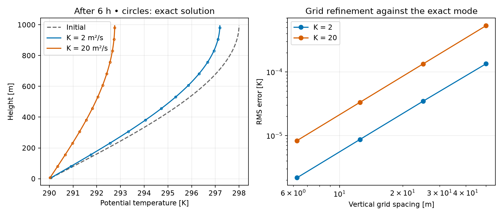

# Atmospheric Dynamics and Modelling

A reproducible, idealized atmospheric column experiment. It shows how vertical mixing changes a dry potential-temperature profile, verifies the solver against an analytical solution, and connects the column model to hydrostatic pressure tendency. All inputs are synthetic.



## Run the experiment

With Python 3.11 or later, from the repository root:

```bash
python -m venv .venv
source .venv/bin/activate
python -m pip install -r requirements.txt
python column.py
python -m unittest discover -s tests -v
```

The script writes a figure and a JSON report under `outputs/`. See the [reference run](docs/metrics.json). No data download is required.

## Experiment: vertical mixing in a dry column

The column is 1 km deep. The lower boundary is held at 290 K and the top has zero flux. An initial potential-temperature anomaly of amplitude 8 K evolves for six hours. Compare constant eddy diffusivities of 2 and 20 m²/s, chosen for illustration.

With potential temperature θ and upward flux F = −K ∂θ/∂z, the model is ∂θ/∂t = −∂F/∂z. The cell-centred solver advances the difference of face fluxes using forward Euler; the lower face uses a half-cell distance. The timestep satisfies K Δt / Δz² ≤ 0.25. Summing over cells cancels interior fluxes, leaving the surface flux as the only way to change the column integral.

The exact anomaly is 8 sin(πz/(2H)) exp[−K(π/(2H))²t], where H is the column depth. Verification compares cell averages against this solution.

| Eddy diffusivity | Initial column anomaly remaining after 6 h | RMS error at 80 cells | Observed order, 80 → 160 cells |
|---|---:|---:|---:|
| 2 m²/s | 89.9% | 8.70 × 10⁻⁶ K | 2.00 |
| 20 m²/s | 34.4% | 3.34 × 10⁻⁵ K | 2.00 |

The stronger diffusivity transfers the anomaly to the fixed-temperature surface more quickly. The column budget residual is below 1.2 × 10⁻¹¹ K·m for both 80-cell runs. These are checks against the idealized equations, not accuracy estimates for real forecasts.

## Connection to METADM coursework

| Course topic | What this repository demonstrates |
|---|---|
| Lecture 1 and Exercise 1: balance and Richardson's forecast | Under hydrostatic balance with fixed top pressure, a constant net mass inflow M across a column of area A gives Δp = gMt/A. The synthetic example yields +1.05948 hPa in six hours; this is not a reconstruction of Richardson's forecast. |
| Lecture 2 and Exercise 2: equations of motion and thermodynamics | The dry potential temperature θ = T(p₀/p)^(Rᵈ/cₚ) is computed in kelvin; a test checks invariance under dry adiabatic displacement. |
| Lecture 3 and Exercise 3: primitive equations and vertical turbulent transport | A constant eddy diffusivity closes only the dry scalar transport equation. The flux budget, analytical benchmark and grid refinement test this reduction. |

The model omits wind, horizontal advection, radiation, moisture and prognostic turbulence. It is a small verification project, not a full primitive-equation or boundary-layer model.

Course context: *Atmospheric Dynamics and Modelling (METADM)*, University of Cologne, lectures by Nikki Vercauteren and exercises by Federica Gucci. This repository uses original code and synthetic inputs; the lecture slides, exercise sheets and provided Richardson notebook are not redistributed. For numerical background, see [Gilbert Strang, The Heat Equation and Convection-Diffusion](https://ocw.mit.edu/courses/18-086-mathematical-methods-for-engineers-ii-spring-2006/resources/am54/).
